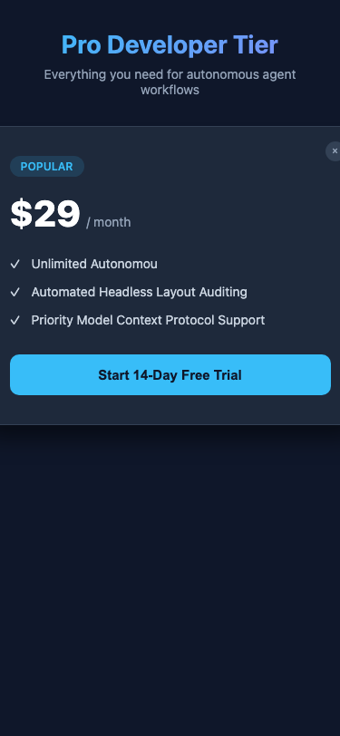

# ViewProbe

**Headless layout verification engine for AI coding agents.**

ViewProbe gives coding agents a fast, deterministic way to catch CSS and layout bugs — overflow, broken responsive layouts, truncated text, undersized tap targets — without relying on expensive vision models or manual human review.

It runs headless Chromium, performs geometric analysis on the rendered DOM, and returns compact, structured diagnostics that an LLM can parse in a single turn. When something breaks, it tells the agent *exactly which element* and *which CSS properties* caused the problem, along with an optional micro-crop screenshot of just the broken region.

## Why

AI coding agents (Cursor, Claude Code, Cline, Aider, etc.) are surprisingly good at writing logic but consistently bad at CSS. They produce layouts that overflow on mobile, text that clips without ellipsis, and buttons too small to tap. The human developer ends up as a visual QA layer, manually checking every UI change.

ViewProbe closes that feedback loop. The agent writes the code, ViewProbe checks the layout across viewports in under a second, and if something breaks, the agent gets back the exact selector and computed styles needed to fix it — no guessing, no print-statement debugging.

## Visual Verification in Action

### Autonomous Self-Healing on Mobile Viewports

When an agent introduces a CSS defect (such as a rigid `min-width` that overflows on mobile, or text clipping without ellipsis), ViewProbe identifies the exact culprit and verifies the fix:

| Before Fix (Broken Layout) | After Fix (Self-Healed) |
| :---: | :---: |
|  |  |
| ❌ *Card overflows 375px screen by 23px, text clipped, 22px button* | ✅ *Fluid responsive bounds, clean ellipsis, 44px accessible touch target* |

## Quick Start

```bash
# install
npm install -g viewprobe

# scan a running page across mobile and desktop
viewprobe check http://localhost:3000

# scan specific viewports
viewprobe check http://localhost:3000 -v mobile,tablet,desktop

# get markdown report instead of JSON
viewprobe check http://localhost:3000 -f markdown

# focus on specific elements
viewprobe check http://localhost:3000 -s ".hero,.pricing-grid"
```

## What It Catches

| Check | Severity | Description |
|-------|----------|-------------|
| **Horizontal Overflow** | error | Elements wider than their container or the viewport, causing unwanted horizontal scroll |
| **Text Truncation** | warning | Text content clipped without `text-overflow: ellipsis` |
| **Tap Target Sizing** | warning | Interactive elements smaller than 44×44px (WCAG 2.5.8) |
| **Body Scroll** | error | Page-level horizontal scroll caused by elements breaking out of the viewport |

## Output Formats

### Agent format (default)

Compact JSON designed for LLM consumption:

```json
{
  "status": "FAIL",
  "url": "http://localhost:3000",
  "duration": "340ms",
  "summary": "Found 1 error and 1 warning across 2 viewports.",
  "violations": [
    {
      "type": "HORIZONTAL_OVERFLOW",
      "severity": "error",
      "viewport": "mobile",
      "message": "Element extends 24px beyond viewport edge",
      "selector": "div.pricing-grid > div:nth-child(2) > button",
      "culpritStyles": [
        "min-width: 400px",
        "flex-shrink: 0"
      ]
    }
  ]
}
```

### Markdown format

Human-readable report with severity badges, bounding box data, and computed style blocks. Good for PR comments or documentation.

### One-liner format

Single line for CI pipelines: `FAIL: 1 layout error(s) — Element extends 24px beyond viewport edge`

## MCP Server

ViewProbe ships as an MCP server so any MCP-compatible agent can use it as a tool:

```json
{
  "mcpServers": {
    "viewprobe": {
      "command": "node",
      "args": ["path/to/viewprobe/dist/mcp-server.js"]
    }
  }
}
```

### Tools

**`viewprobe_check`** — Scan a URL for layout violations.

| Parameter | Type | Required | Description |
|-----------|------|----------|-------------|
| `url` | string | yes | URL to scan |
| `viewports` | string | no | Comma-separated: mobile, tablet, desktop, wide |
| `selectors` | string | no | CSS selectors to focus on |
| `skipSelectors` | string | no | CSS selectors to skip |
| `microCrops` | boolean | no | Attach cropped violation screenshots (default: true) |

**`viewprobe_viewports`** — List available viewport presets with dimensions.

## Micro-Crops (~80 tokens vs ~1,500 tokens)

Instead of sending a full-page screenshot (1,500+ vision tokens), ViewProbe computes the exact screen-space bounding box of the violation, highlights it with a red debug border, and crops only that region (~80 tokens):

<p align="center">
  
</p>

You can disable micro-crops with `--no-crops` or `microCrops: false` in the MCP call.

## Programmatic API

```typescript
import { ProbeEngine, formatForAgent } from "viewprobe";

const engine = new ProbeEngine();
const result = await engine.probe({
  url: "http://localhost:3000",
  viewports: [
    { name: "mobile", width: 375, height: 812 },
    { name: "desktop", width: 1280, height: 900 },
  ],
});

console.log(formatForAgent(result));
await engine.close();
```

## Development

```bash
git clone https://github.com/Umang-sudo-su/ViewProbe.git
cd ViewProbe
npm install
npm run build
npm test
```

## License

MIT
